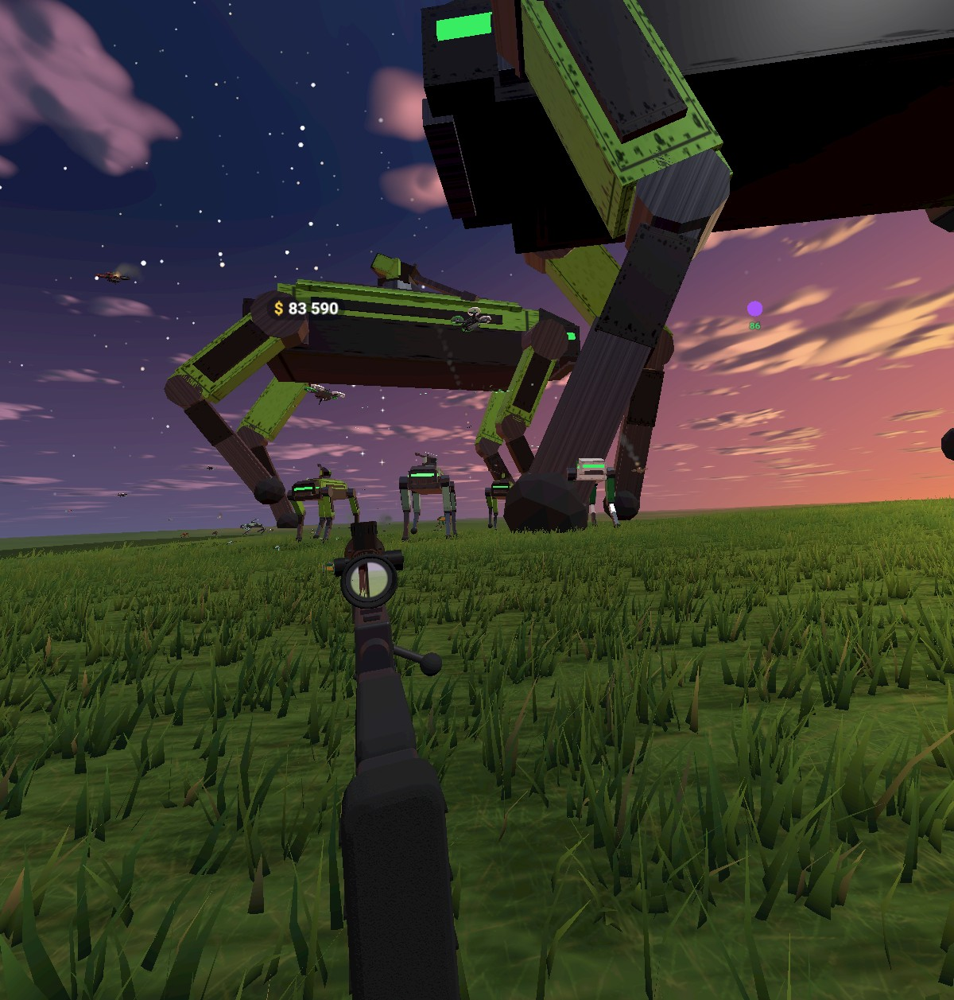
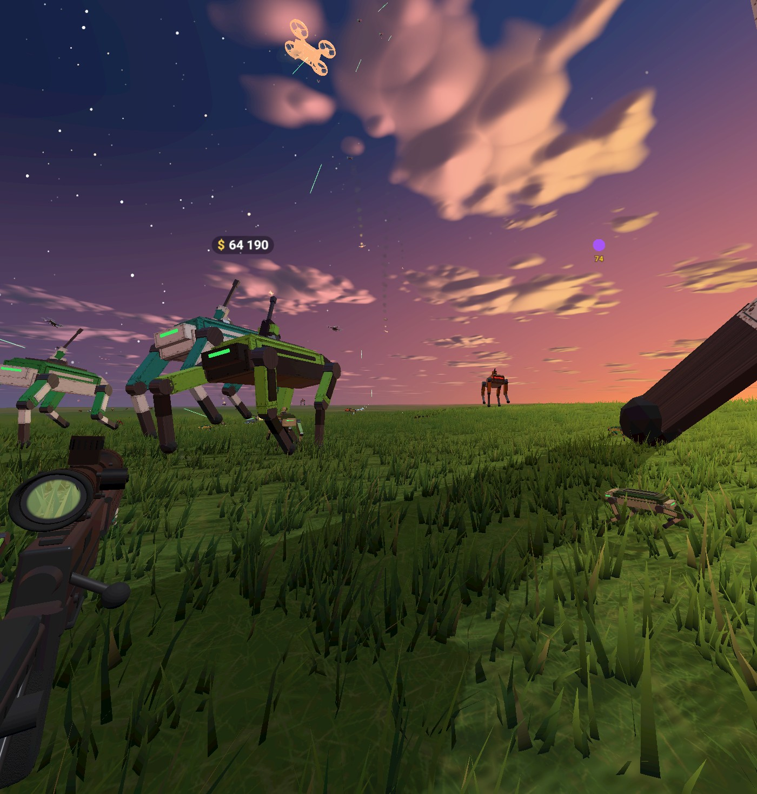
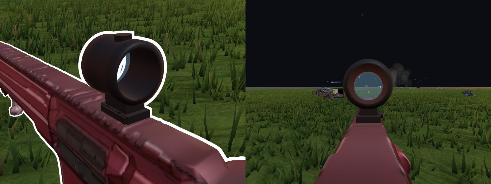
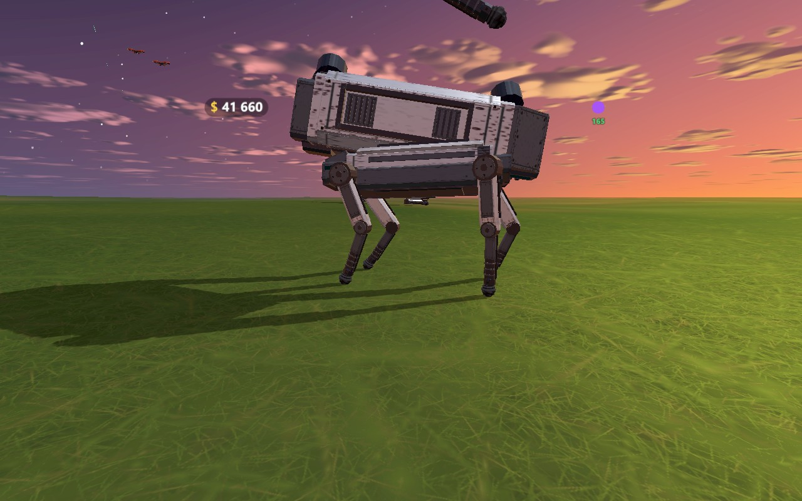

# VR Voice Dev

Разработка голосом внутри VR на Quest 3S, одной левой рукой: зажал курок, сказал, что сделать,
отпустил — Claude Code меняет сцену, и она обновляется перед глазами без выхода из VR.

## Скриншоты

| | |
|---|---|
|  |  |
| Бой на эпохе «Конец»: огромные робособаки (снимок из Quest 3S) | Союзники разных раскрасок, тени по солнцу, дроны в небе (Quest 3S) |
|  |  |
| Сгенерированная пушка с рабочим коллиматором: точка без параллакса | Детальная модель большой робособаки: панели, решётки, суставы, стопы |

## Запуск на ПК

```
npm start
```

В консоли появятся адрес для шлема и код сопряжения. Остановить — `Ctrl+C`.

Требования, которые уже выполнены на этой машине: Node 24, Python 3.12 в `.venv`, Claude Code
с входом через claude.ai и включённой диктовкой, установленный Steam (его виртуальный микрофон
используется, чтобы передать голос из шлема в Claude Code).

## Первый раз в шлеме

Всё делается курком левого контроллера в браузере Quest:

1. Открыть адрес из консоли, например `https://<адрес-ПК>:<порт>/`.
2. На предупреждении о сертификате: «Дополнительно» → «Перейти на сайт».
3. Ввести код сопряжения (8 символов) — он запоминается.
4. Нажать «Войти в VR» и разрешить микрофон. Если после разрешения вход не случился —
   нажать кнопку ещё раз.

Браузер помнит разрешение для сертификата около недели, потом шаг 2 придётся повторить.

## Управление (левый контроллер)

| Кнопка | Действие |
|---|---|
| Курок (держать) | Говорить. При отпускании фраза отправляется Claude (от трёх слов) |
| X | Enter: отправить короткую фразу, подтвердить запрос Claude |
| Y | Esc: отменить запись, прервать Claude |
| Стик вверх/вниз | Прокрутка окна терминала |
| Grip + стик | Стрелки вверх/вниз в меню Claude |
| Нажать стик и держать 1 с | Принудительно перезагрузить страницу |

Полоса вверху окна показывает состояние: «курок — говорить», «секунду…», «ГОВОРИТЕ», «распознаю…».

## Настройки (`config.json`)

Свой `config.json` в репозиторий не попадает: скопируй `config.example.json` в `config.json` и впиши
в `lan_host` адрес своего ПК в домашней сети.

- `lan_host` — адрес ПК в домашней сети. Страница доступна только по нему. Если роутер выдаст
  ПК другой адрес — поменять здесь (лучше закрепить адрес в роутере).
- `terminal` — размер окна терминала в символах.
- `audio.mic_gain_db` — усиление микрофона шлема, если Claude плохо слышит (например, `6`).
- `claude.model`, `claude.effort` — модель и усилие VR-сессии. По умолчанию быстрый вариант.

## Если что-то не так

- **После перезагрузки страницы выбросило из VR.** В браузере Quest открыть
  `chrome://flags/#webxr-navigation-permission`, поставить Allowed.
- **Нет звука / Claude не слышит.** Убедиться, что Steam установлен и в Windows есть устройство
  «Microphone (Steam Streaming Microphone)». Запасной вариант — VB-Cable (имена устройств
  задаются в `config.json`).
- **Микрофон Windows «по умолчанию» остался виртуальным** (после аварийного завершения) —
  запустить `npm start` ещё раз: при старте мост возвращает исходные устройства.
- **Страница не открывается в шлеме.** Шлем и ПК должны быть в одной сети Wi‑Fi; проверить
  `lan_host`.

## Проверка без шлема

```
.venv\Scripts\python -m pytest -q          # мост
npm test                                   # страница
.venv\Scripts\python scripts\e2e_voice.py  # «ложный шлем»: диктует фразу и ждёт ответа Claude
```

## Тарелочник

Глиняные тарелки (`web/src/scene/clays.js`) появились по одной голосовой фразе из шлема
16 ноября 2026 года: от просьбы до первой сбитой брошенной тарелкой мишени прошло около
7 минут. Сделал их отдельный агент, которого за узость призвания прозвали **Тарелочником**.
Тарелочник прошёл два испытания прямо на глазах у игрока в шлеме:

- сбил мишень своей тарелкой с первого броска (расчётный промах — 4 мм);
- одним залпом из 18 тарелок положил все 18 мишеней: попадания уложились в 28 мс.

Награждён медалью 🏅. Кнопка X спавнит тарелку у руки, курок берёт её и взводит бросок, замах
вперёд — тарелка летит; летящую тарелку можно сбить выстрелом.
